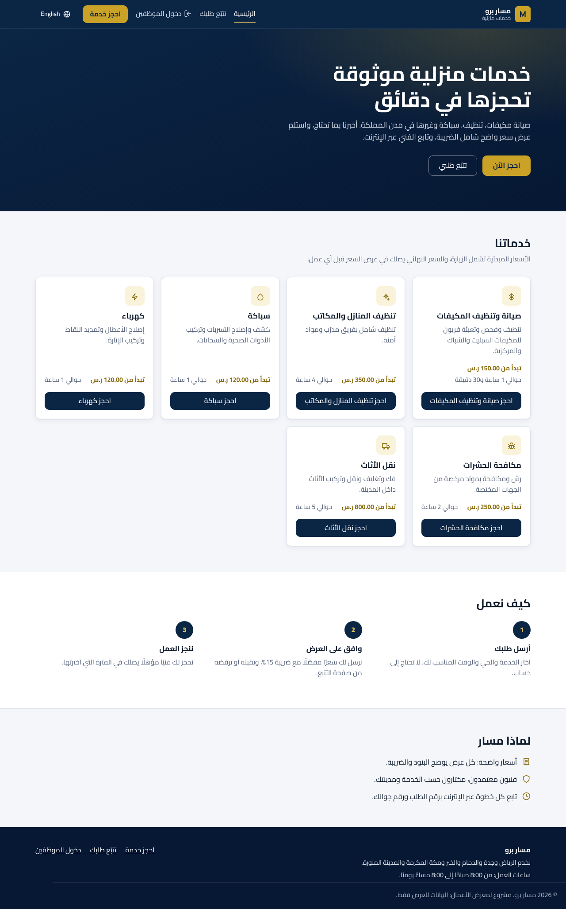
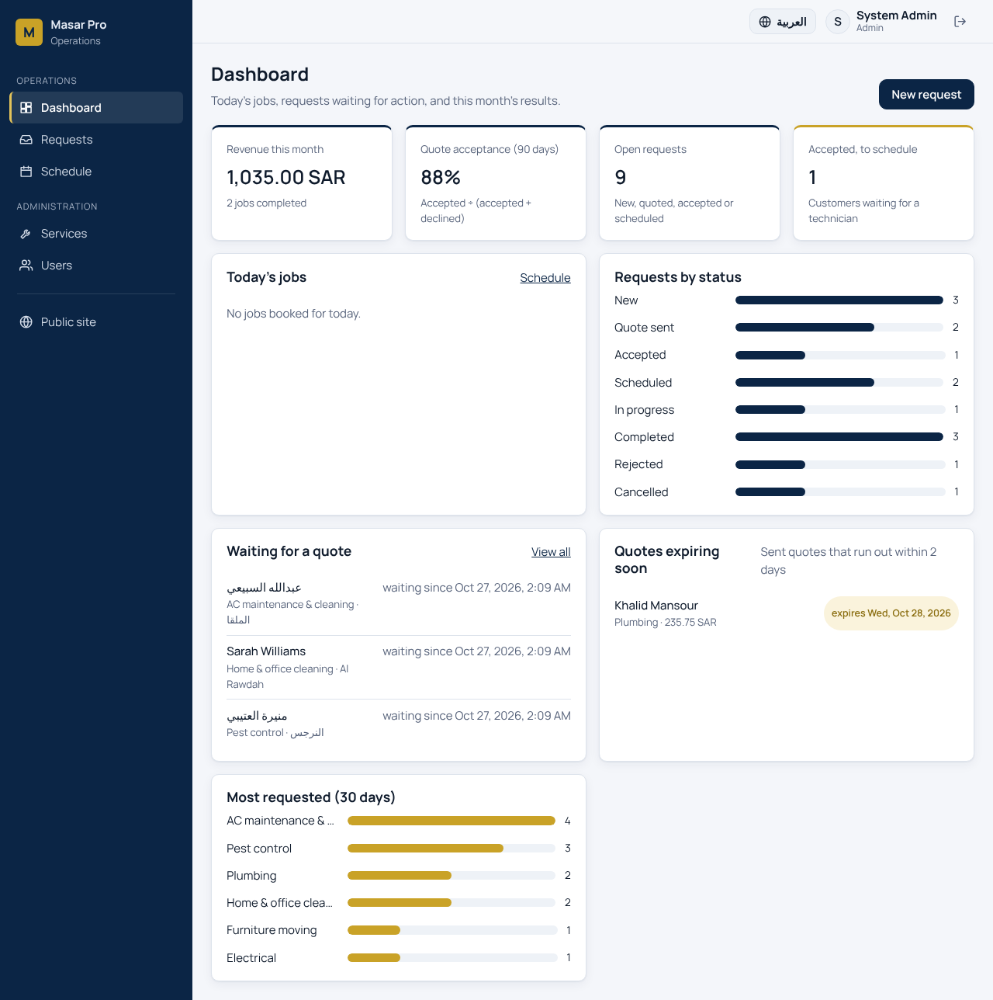
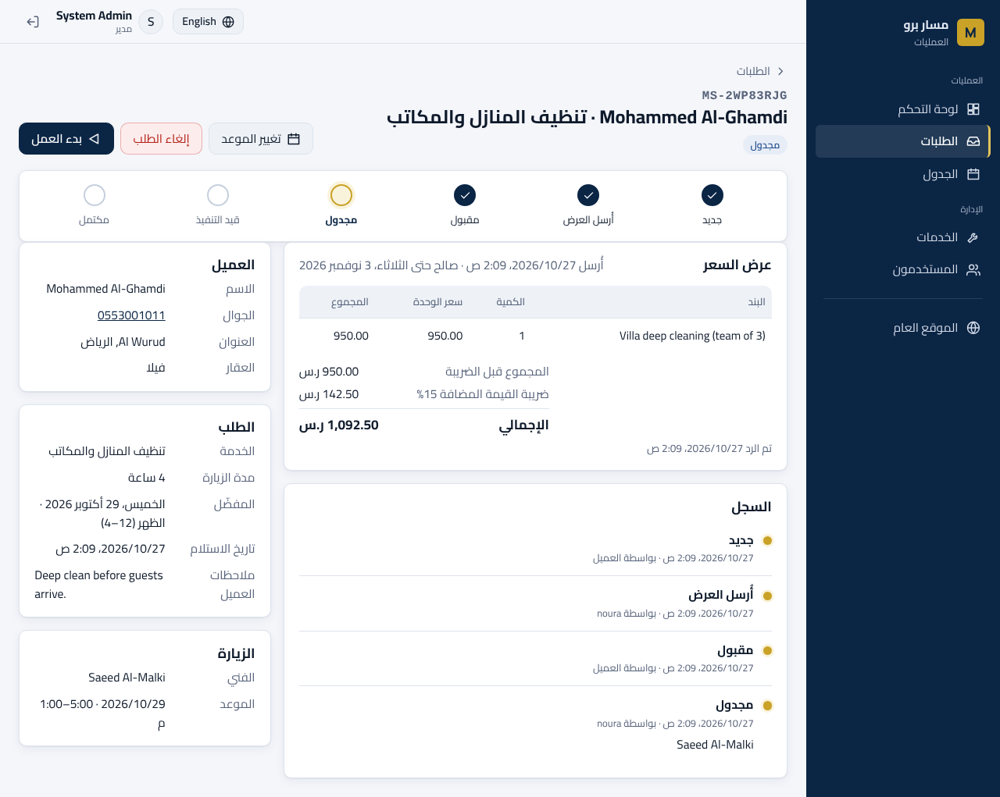
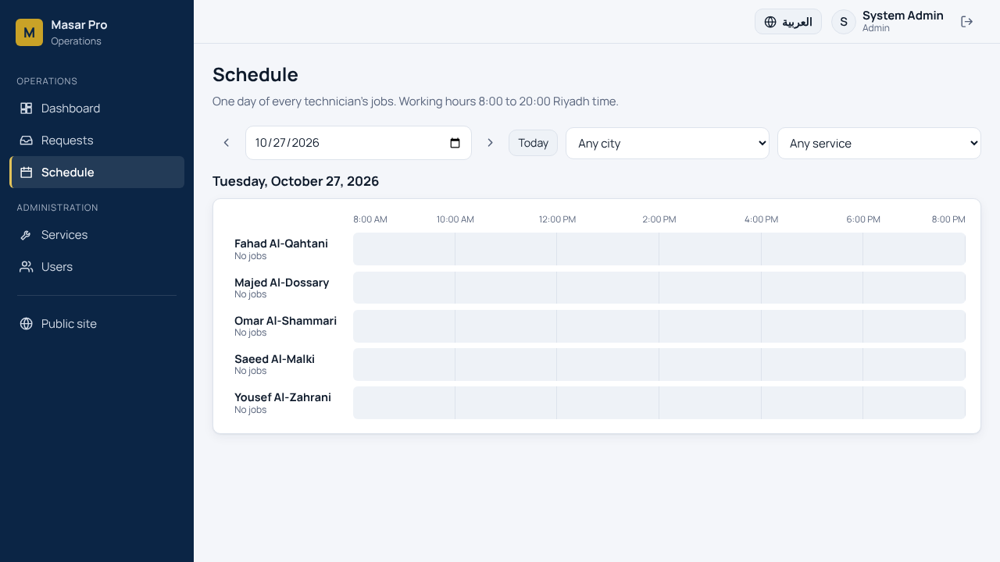
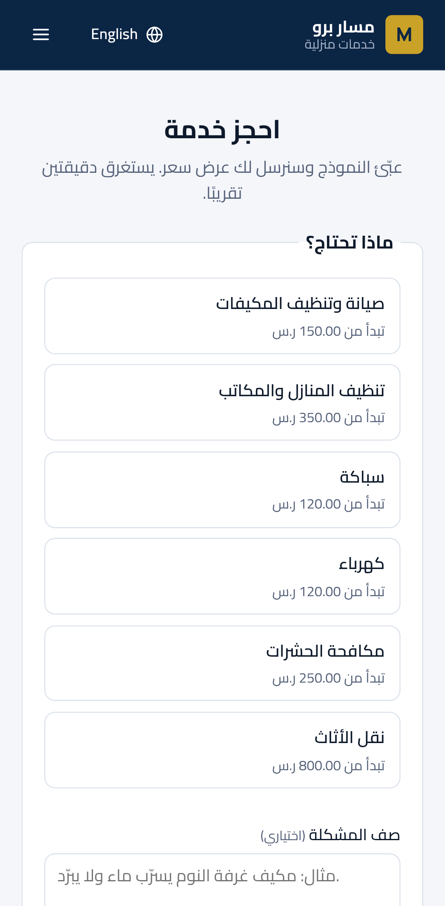
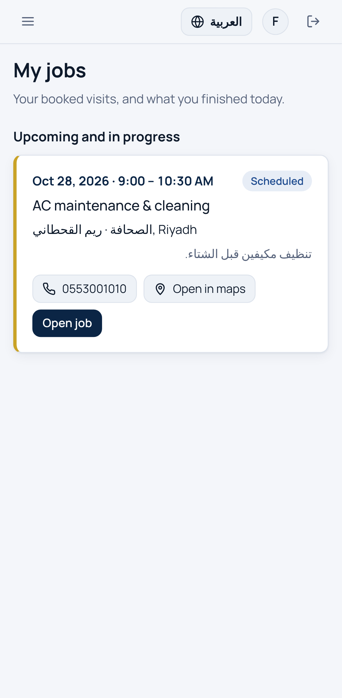

# Masar Pro

A booking system for home-service companies in Saudi Arabia (AC maintenance, cleaning, plumbing and more). Customers book on a public website, approve an itemised quote with 15% VAT and track their request. The office prepares quotes and schedules technicians, and technicians run their jobs from their phones. The UI is in **Arabic and English** (RTL / LTR).

**Stack:** a Java 21 / Spring Boot 4 REST API, an Angular 21 frontend and PostgreSQL 17, all run with Docker Compose.

[العربية ↓](#بالعربية)

| Public site (Arabic) | Office dashboard (English) |
| --- | --- |
|  |  |

| Request with quote (Arabic) | Technicians' day (English) |
| --- | --- |
|  |  |

| Mobile: booking | Mobile: technician's jobs |
| --- | --- |
|  |  |

## Features

- **Public booking, no account needed.** The customer picks a service from the live catalogue, their city and district, a preferred day (today to 60 days ahead) and a time slot. Slots that have already passed today cannot be picked. The customer gets a random reference such as `MS-7K3QX9PA`.
- **Tracking needs the reference and the mobile number.** A wrong phone gets the same "not found" answer as a wrong reference, so a guessed reference reveals nothing. The page shows the progress, the quote, the booked visit and the history, without staff usernames or internal notes.
- **Quotes with VAT.** The office writes item lines. The server calculates the subtotal and 15% VAT (rounded once, half-up) and stores the totals, so a sent price never changes. A quote is a draft until it is sent. The customer accepts or declines it with a reason. An expired quote cannot be accepted. A declined quote can be reopened and revised.
- **Scheduling rules enforced by the server.** A technician must be active, work in the request's city and have the skill for the service. The visit must start on the half hour, in the future, and fit between 08:00 and 20:00 Riyadh time. It must not overlap the technician's other jobs. The technician row is locked while booking, so two dispatchers booking the same slot at the same moment cannot both succeed (there is a test for this).
- **Day board.** The schedule page shows every technician's jobs as a timeline. The booking dialog shows the qualified technicians' day with the proposed visit drawn on it.
- **Technician app.** Technicians see only their own jobs, with call and map buttons, and start and complete them.
- **Dashboard.** It shows revenue and completed jobs this month, quote acceptance over 90 days (left empty when no quote was answered, rather than 0%), requests by status, today's jobs, requests waiting for a quote and quotes about to expire.
- **Roles.** Admins manage services and users. Dispatchers handle requests, quotes and scheduling. Technicians see their jobs. Each rule is checked on the server, not only hidden in the UI.
- **Anti-spam.** Public forms have a honeypot field (bots get a fake success and nothing is saved) and a per-IP rate limit (5 bookings and 30 lookups per 10 minutes by default; answers `429` with `Retry-After`).
- **Optimistic locking.** Every action sends the version the page loaded. If two people work on the same request, the second gets a clear "someone else changed this" message instead of overwriting.

## Quick start (Docker)

```bash
cp .env.example .env          # then set JWT_SECRET (e.g. openssl rand -base64 48) and DB_PASSWORD
docker compose up --build
```

Open <http://localhost:8083>. Staff sign in at <http://localhost:8083/login>. The API documentation (Swagger UI) is at <http://localhost:8083/swagger-ui/index.html>.

**Database.** PostgreSQL runs in the `db` container and keeps its data in the `db-data` Docker volume. Flyway creates the tables when the API starts. To browse it, connect a tool such as DBeaver to `localhost:5443`, database `masar`, with `DB_USERNAME` / `DB_PASSWORD` from `.env`. Or run `docker compose exec db psql -U masar -d masar`. `docker compose down -v` deletes the data.

Demo accounts and sample requests (in every status) are created on the first start when `SEED_DEMO_DATA=true`:

| User | Password (default) | Role |
| --- | --- | --- |
| `admin` | `Admin@12345` | Admin |
| `noura` | `Staff@12345` | Dispatcher |
| `fahad`, `omar`, `saeed` (Riyadh), `yousef` (Jeddah), `majed` (Dammam) | `Staff@12345` | Technician |

Change the passwords in `.env`. For a real installation, set `SEED_DEMO_DATA=false` and create users from the Users page.

## Local development

You need Java 21, Node 22 and Docker (for PostgreSQL and the Testcontainers tests).

```bash
docker run -d --name masar-db -e POSTGRES_DB=masar -e POSTGRES_USER=masar \
  -e POSTGRES_PASSWORD=masar -p 5432:5432 postgres:17-alpine
cd backend && ./mvnw spring-boot:run          # API on :8080
cd frontend && npm ci && npm start            # UI on :4200, /api is proxied to :8080
```

## Tests and checks

| Command | What it checks |
| --- | --- |
| `cd backend && ./mvnw verify` | 44 tests. Integration tests use a real PostgreSQL via Testcontainers: auth and roles, booking and tracking, quotes and VAT, scheduling rules and the concurrent-booking race, the rate limit, catalogue and users, dashboard numbers and demo-data consistency. There are also unit tests for the domain rules. |
| `cd frontend && npm run lint` | ESLint, including the Angular template accessibility rules |
| `cd frontend && npm run format:check` | Prettier |
| `cd frontend && npm run check:i18n` | Every translation key used in templates exists |
| `cd frontend && npm run test:ci` | 31 unit tests: phone and reference rules, Riyadh dates and times, VAT preview, the status stepper, error messages, the token never sent to public endpoints, dictionary parity |
| `cd e2e && npm ci && npx playwright test` | 27 browser tests on desktop and mobile against the running stack, including the full flow: book → quote → customer accepts → schedule → technician completes |

GitHub Actions runs all of these on every push. See `.github/workflows/ci.yml`.

## Project structure

```
backend/    Spring Boot API: one package per feature (request, catalog, user, dashboard, auth, security, ...)
  src/main/resources/db/migration   Flyway SQL migrations (the schema is never auto-generated)
frontend/   Angular app: core/ (api, auth, i18n, ui), features/ (public site and staff pages), shared/, layout/
e2e/        Playwright end-to-end tests
docs/       Screenshots
```

## Design decisions

- **One status machine** (`RequestStatus`) lists the allowed moves. Every endpoint, staff or public, checks the same table, and every move is written to the request history in the same transaction.
- **Prices are stored, not recalculated.** The quote keeps its subtotal, VAT and total, and database `CHECK` constraints make sure `total = subtotal + vat` and `line_total = quantity × unit_price`.
- **Business time is Riyadh time** everywhere: working hours, "today", "this month" and quote validity. Saudi Arabia has no daylight saving time, so 08:00–20:00 is always the same UTC window.
- **Phones are stored in one form** (`9665XXXXXXXX`), so `05…`, `+966…` and `00966…` all find the same request.
- **Errors use RFC 9457 Problem Details** with a machine-readable `code`. The UI translates the code, so server messages are never shown raw.
- **nginx is the edge.** It overwrites `X-Forwarded-For` with the visitor's address, so the per-IP rate limit cannot be bypassed with a fake header.

## Known limitations

- There are no SMS or email notifications. The customer follows the request on the tracking page.
- No online payment. The quote is accepted online and paid on site.
- Addresses are free text and the map button searches by address. There are no coordinates or route planning.
- The rate limiter keeps its counters in memory, so it is per API instance. Several instances would need a shared store such as Redis.
- The Docker images are built and started in CI. On the development machine used for this project, the stack was verified with the same runtime images and locally built artifacts.

---

## بالعربية

**مسار برو** نظام حجز لشركات الخدمات المنزلية في السعودية (صيانة المكيفات، التنظيف، السباكة وغيرها). العميل يحجز من الموقع العام، ويوافق على عرض سعر مفصّل مع ضريبة 15%، ويتابع طلبه. المكتب يجهّز العروض ويجدول الفنيين، والفني يدير أعماله من جواله. الواجهة **بالعربي والإنجليزي** (من اليمين لليسار ومن اليسار لليمين).

**التقنيات:** واجهة API بلغة Java 21 و Spring Boot 4، وواجهة أمامية Angular 21، وقاعدة بيانات PostgreSQL 17، وكلها تشتغل بـ Docker Compose.

### المزايا

- **حجز عام بدون حساب.** العميل يختار الخدمة والمدينة والحي واليوم المفضّل (من اليوم إلى 60 يومًا) والفترة. الفترات اللي انتهت اليوم ما تنختار. ويستلم رقم طلب عشوائي مثل `MS-7K3QX9PA`.
- **التتبع يحتاج رقم الطلب ورقم الجوال.** الجوال الخطأ ياخذ نفس رد "غير موجود" مثل رقم الطلب الخطأ، فالرقم المخمّن ما يكشف شي. والصفحة تعرض المراحل والعرض والموعد والسجل بدون أسماء دخول الموظفين.
- **عروض أسعار مع الضريبة.** المكتب يكتب البنود، والخادم يحسب المجموع وضريبة 15% (تقريب مرة وحدة) ويحفظها. العرض مسودة لين ينرسل. العميل يقبل أو يرفض مع السبب، والعرض المنتهي ما ينقبل، والمرفوض يمكن إعادة فتحه.
- **قواعد الجدولة في الخادم.** الفني لازم يكون نشط، وفي نفس المدينة، وعنده مهارة الخدمة. والزيارة تبدأ على رأس الساعة أو نصها، في المستقبل، وبين 8 الصبح و8 الليل بتوقيت الرياض، وبدون تداخل مع أعماله. ولو منسّقين حجزوا نفس الوقت في نفس اللحظة، ينجح واحد بس (وعليه اختبار).
- **لوحة اليوم.** صفحة الجدول تعرض أعمال كل فني كخط زمني، ونافذة الحجز تعرض يوم الفنيين المؤهلين مع الموعد المقترح مرسوم عليه.
- **تطبيق الفني.** الفني يشوف أعماله بس، مع زر اتصال وزر خريطة، ويبدأ وينهي الشغل.
- **لوحة التحكم.** إيراد الشهر والأعمال المكتملة، ونسبة قبول العروض آخر 90 يوم، والطلبات حسب الحالة، وأعمال اليوم، والطلبات اللي تنتظر عرض، والعروض اللي قربت تنتهي.
- **الصلاحيات.** المدير يدير الخدمات والمستخدمين، والمنسّق يدير الطلبات والعروض والجدولة، والفني يشوف أعماله. كل قاعدة مفحوصة في الخادم.
- **منع الإزعاج.** حقل مصيدة للبوتات، وحد طلبات لكل IP (5 حجوزات و30 بحث كل 10 دقائق افتراضيًا).

### التشغيل السريع

```bash
cp .env.example .env          # وبعدها حط قيمة JWT_SECRET و DB_PASSWORD
docker compose up --build
```

افتح <http://localhost:8083>، ودخول الموظفين من <http://localhost:8083/login>.

**قاعدة البيانات:** تشتغل داخل حاوية `db` وتنحفظ بياناتها في `db-data`. تقدر تفتحها من DBeaver على `localhost:5443`، وقاعدة البيانات `masar`، باسم المستخدم وكلمة المرور من `.env`.

الحسابات التجريبية: `admin` / `Admin@12345` (مدير)، `noura` / `Staff@12345` (منسّقة)، والفنيين `fahad` و`omar` و`saeed` (الرياض) و`yousef` (جدة) و`majed` (الدمام) بكلمة المرور `Staff@12345`.

### الاختبارات

- الباكند: 44 اختبار على PostgreSQL حقيقي (`./mvnw verify`).
- الفرونت: 31 اختبار وحدة، مع ESLint و Prettier وفحص مفاتيح الترجمة.
- المتصفح: 27 اختبار Playwright على الكمبيوتر والجوال، منها المسار كامل من الحجز لين إنهاء الشغل.

كلها تشتغل في GitHub Actions مع كل push.

### حدود معروفة

- ما فيه رسائل SMS أو بريد؛ العميل يتابع من صفحة التتبع.
- ما فيه دفع إلكتروني؛ العرض ينقبل أونلاين والدفع في الموقع.
- العنوان نص حر، وزر الخريطة يبحث بالعنوان.
- عداد حد الطلبات في الذاكرة، فهو لكل نسخة من الـ API.
